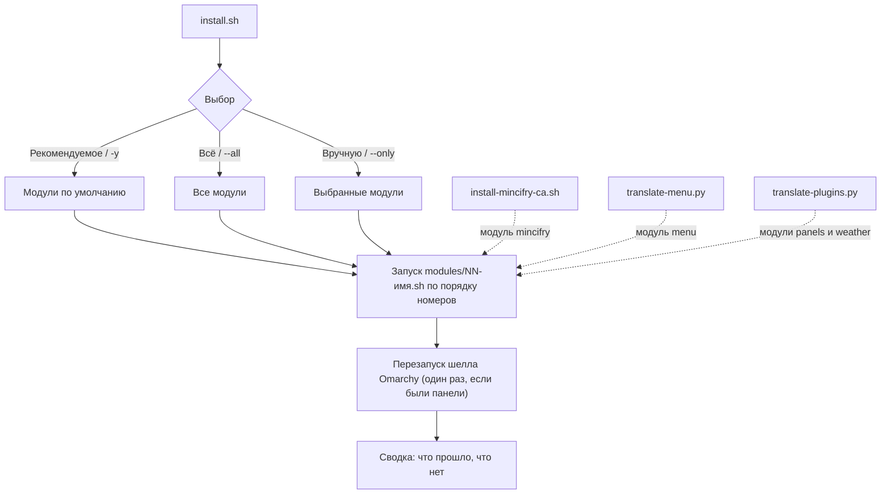
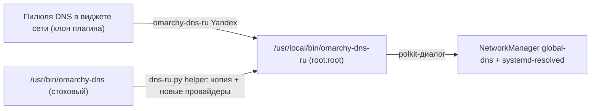
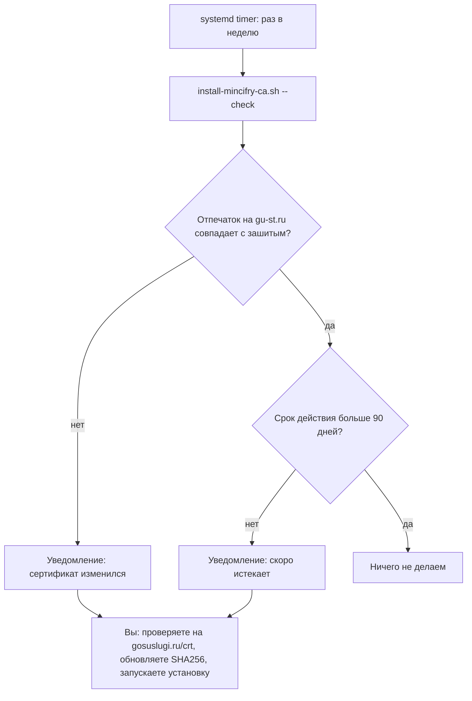

# omarchy-rus

🌐 **Русский** · [English](README.en.md)

[](https://github.com/chastnik/omarchy-rus/actions/workflows/ci.yml)
[](https://github.com/chastnik/omarchy-rus/releases/latest)
[](LICENSE)
[](https://omarchy.org)
[](https://github.com/chastnik/omarchy-rus/stargazers)
[](https://github.com/chastnik/omarchy-rus/commits/main)


Русификация Omarchy (Arch + Hyprland): локаль, язык интерфейса, раскладка, речь, сертификаты Минцифры и прочие «русские» мелочи.
Всё устроено как набор независимых **модулей**; при запуске `install.sh` вы собираете «корзину» из нужных.

> **Важно (v2.0):** Начиная с Omarchy 3.8+, в апстриме появилась [нативная i18n](https://github.com/omacom/omarchy/tree/main/default/i18n/ru)
> с полным русским языковым пакетом (меню, панели бара, горячие клавиши, уведомления).
> Этот проект больше **не клонирует плагины для перевода** — он использует нативную i18n и добавляет только то,
> чего в Omarchy нет: локаль, раскладку, DNS для России, сертификаты Минцифры, голосовой ввод и т.д.
>
> Если у вас установлена версия 1.x — сначала откатите её: `./uninstall.sh`, затем установите новую.

## Установка по шагам
Нужно: Omarchy, обычный пользователь (не root), терминал и `sudo`.

1. **Скачайте архив** последнего релиза: откройте [страницу релизов](https://github.com/chastnik/omarchy-rus/releases/latest)
   и нажмите `omarchy-rus.tar.gz`. Либо одной командой в терминале:
   ```bash
   curl -fLO https://github.com/chastnik/omarchy-rus/releases/latest/download/omarchy-rus.tar.gz
   ```
2. **Проверьте целостность** (по желанию). Скачайте рядом `omarchy-rus.tar.gz.sha256` и выполните в той же папке:
   ```bash
   sha256sum -c omarchy-rus.tar.gz.sha256      # должно быть: omarchy-rus.tar.gz: ЦЕЛ (OK)
   ```
3. **Распакуйте и перейдите в папку:**
   ```bash
   tar xzf omarchy-rus.tar.gz && cd omarchy-rus
   ```
4. **Посмотрите, что умеет установщик** (по желанию): `./install.sh --list`
5. **Запустите установку:**
   ```bash
   ./install.sh
   ```
   Выберите «Рекомендуемое», «Всё» или «Выбрать вручную» (Пробел — отметить, Enter — продолжить). Введите пароль `sudo`, когда спросят.
6. **Перезайдите в сессию** (выйдите и войдите снова), чтобы применился язык интерфейса.

**Обновление:** скачайте новый релиз и повторите шаги 1–5; установщик идемпотентен. Версия установленного архива: `./install.sh --version`.
**Без релиза (последняя версия из репозитория):** `git clone https://github.com/chastnik/omarchy-rus && cd omarchy-rus && ./install.sh`.

## Быстрый старт
    ./install.sh                # интерактивный выбор: «Рекомендуемое» / «Всё» / «Выбрать вручную»
    ./install.sh --list         # каталог модулей с описаниями
    ./install.sh --all          # всё, включая необязательное (ЭЦП, сертификаты Минцифры)
    ./install.sh -y             # только рекомендуемое, без вопросов
    ./install.sh --only timezone,telegram     # только указанные (id из --list)
    ./install.sh --skip voxtype,tts           # рекомендуемое, кроме указанных
    ./install.sh --dry-run ...  # показать, что будет выполнено, и выйти

Интерфейс выбора: `gum` (есть в Omarchy; Пробел — отметить, Ctrl+A — выбрать всё), без него — текстовое меню.
Модули, которым нужен `sudo`, запрашивают пароль один раз. Сбой одного модуля не останавливает остальные;
в конце выводится сводка. Шелл Omarchy перезапускается один раз в конце, если менялись панели.
После установки перезайдите в сессию.

## Модули
| id | Группа | По умолч. | Что делает |
|----|--------|:---:|------------|
| `language` | Базовая | ✓ | `omarchy language ru` — генерирует локаль, LANG, язык интерфейса (меню, панели, горячие клавиши, уведомления) |
| `hypr-layout` | Базовая | ✓ | `us,ru` в `~/.config/hypr/input.lua` (с бэкапом), перезагрузка Hyprland |
| `spell` | Базовая | ✓ | `hunspell-ru`, `aspell-ru`, `man-pages-ru` |
| `timezone` | Простое | ✓ | часовой пояс (`Europe/Moscow`, переменная `RUS_TZ`) и `ru.pool.ntp.org` для timesyncd |
| `xcompose` | Простое | ✓ | блок в `~/.XCompose`: `₽` `№` `«»` `—` `–` `…` (Compose = Caps Lock) |
| `touchpad-scroll` | Простое | — | натуральная прокрутка тачпада (как на MacBook) в `~/.config/hypr/input.lua` (с бэкапом) |
| `touchpad-gestures` | Простое | — | жест тремя пальцами влево/вправо для смены рабочих столов (с бэкапом) |
| `vconsole-font` | Простое | ✓ | кириллический шрифт TTY (`LatArCyrHeb-16`), действует после перезагрузки |
| `office` | Простое | ✓ | LibreOffice: русский пакет, переносы, тезаурус (если LibreOffice установлен) |
| `telegram` | Приложения | ✓ | `telegram-desktop` |
| `browsers` | Приложения | ✓ | Chromium/Brave/Chrome: `--lang=ru` и `--accept-lang` в файле флагов; Firefox: пакет `firefox-i18n-ru` |
| `weather` | Приложения | ✓ | виджет погоды: `unit=metric`, геокодинг городов на русском |
| `dns` | Приложения | ✓ | пилюли DNS для России в виджете сети (Yandex, DNS4EU, NextDNS) + root-helper `omarchy-dns-ru` |
| `emoji-ru` | Интерфейс | ✓ | русские ключевые слова для поиска эмодзи («сердце», «рука», «грусть»…) |
| `voxtype` | Приложения | ✓ | русское распознавание речи (Parakeet), см. ниже |
| `fastfetch` | Интерфейс | ✓ | `~/.config/fastfetch/config.jsonc` с русскими заголовками («О системе») |
| `tts` | Интерфейс | ✓ | `speech-dispatcher` + `espeak-ng`, язык по умолчанию — русский |
| `piper` | Приложения | — | нейросетевой русский голос Piper (Irina, офлайн), команда `say-ru`, модуль speech-dispatcher |
| `ecp` | Работа | — | PC/SC для ЭЦП: `pcsclite`, `ccid`, `opensc`, `pcsc-tools`, `pcscd` |
| `mincifry` | Работа | — | сертификаты Минцифры + еженедельная автопроверка срока |



## Структура проекта
| Файл | Назначение |
|------|------------|
| `install.sh` | оркестратор: выбор модулей, sudo, запуск, сводка |
| `uninstall.sh` | полный откат: клоны плагинов, расширение меню, обёртки клавиш, хук, DNS-хелпер, сертификаты |
| `modules/NN-имя.sh` | модули; метаданные в шапке (`title`, `group`, `default`, `sudo`, `desc`) |
| `merge-emoji-ru.py` | добавляет русские ключевые слова к поиску эмодзи |
| `dns-ru.py` | генератор root-helper и правка виджета сети для модуля `dns` |
| `data/emojis-ru.json` | русские названия эмодзи (CLDR, 1870 записей) |
| `.github/workflows/` | CI (`ci.yml`) и сборка релиза по тегу (`release.yml`) |
| `CHANGELOG.md` | список изменений; раздел версии становится описанием релиза |
| `install-mincifry-ca.sh` | сертификаты Минцифры и мониторинг срока |

## Перевод интерфейса — нативная i18n Omarchy

Начиная с Omarchy 3.8+, в апстриме есть [нативная система переводов](https://github.com/omacom/omarchy/tree/main/default/i18n/ru):
- `default/i18n/ru/menu.json` — меню Omarchy (1217 строк)
- `default/i18n/ru/shell.json` — строки панелей бара (533 строки, с ICU-плюрализацией)
- `default/i18n/ru/keybindings.json` — описания горячих клавиш (188 строк)
- `default/i18n/ru/cli.json` — CLI и уведомления (326 строк)

Модуль `language` вызывает `omarchy language ru`, который генерирует локаль `ru_RU.UTF-8`,
пишет код языка в `~/.config/omarchy/language` и настраивает session LANG.
Переключение происходит без перезапуска шелла (i18n-система следит за файлом языка).

Перевод обновляется автоматически с каждым `omarchy update` — не нужно поддерживать словари вручную.

### Что переводит omarchy-rus дополнительно
- **Поиск эмодзи** (`emoji-ru`): к полю `k` в `emojis.json` дописываются русские названия (CLDR),
  чтобы эмодзи можно было искать по-русски. UI-строки (placeholder, «нет совпадений») — в нативной i18n.
- **Геокодинг погоды** (`weather`): API open-meteo получает `language=ru` вместо `language=en`
  для поиска городов на русском. Единицы — `unit=metric` в `shell.json`.
- **DNS для России** (`dns`): провайдеры Cloudflare/Google заменяются на Yandex/DNS4EU/NextDNS.
  Это единственный клон плагина — имена провайдеров захардкожены в QML и `omarchy-dns`.

## Заметки
- Шрифты (Noto, Liberation) уже поддерживают кириллицу; `fcitx5` установлен.
- Firefox: `omarchy pkg add firefox-i18n-ru`. Chromium и LibreOffice берут язык из системы
  (для LibreOffice может понадобиться отдельный language pack).
- Чтобы оставить английский интерфейс, но печатать по-русски, уберите шаг с `LANG`.
- Файлы Omarchy в `/usr/share/omarchy/` не трогаем — только `~/.config/`.

## voxtype (голосовой ввод)
Модуль `voxtype` включает ONNX-сборку voxtype (`sudo voxtype setup onnx --enable`), скачивает
`parakeet-tdt-0.6b-v3-int8` (мультиязычная, русский поддерживается) и только после успешной
загрузки переключает `engine = "parakeet"`.
Известная проблема: `models.voxtype.io` может отдавать файл (~650 МБ) очень медленно;
при неудаче скрипт качает те же файлы с зеркала Hugging Face (`istupakov/parakeet-tdt-0.6b-v3-onnx`) с докачкой и проверкой sha256.

### Если voxtype выдаёт пустой текст или английский мусор
Проверьте уровень микрофона: на некоторых ноутбуках `Internal Mic Boost` = 100% и `Capture` = 100%
дают клиппинг (peak 32768). Скрипт ставит Boost=1, Capture=60% (`amixer -c 0 ...`).
Диагностика: `arecord -D default -f S16_LE -r 16000 -c 1 -d 5 t.wav && voxtype transcribe t.wav`.

## Откат установки (`uninstall.sh`)
Полный откат всего, что установил omarchy-rus:
```bash
./uninstall.sh            # удалить артефакты (клоны, меню, клавиши, хук, DNS, fastfetch, сертификаты)
./uninstall.sh --dry-run  # показать, что будет удалено
./uninstall.sh --purge    # дополнительно: пакеты, локаль, раскладка, язык Omarchy
```
По умолчанию НЕ трогает: локаль, раскладку, XCompose, шрифт TTY, пакеты, часовой пояс, voxtype, TTS.

## DNS в виджете сети (`dns`, `dns-ru.py`)
Стоковые пилюли — Cloudflare и Google, а `omarchy-dns` принимает только их (+ DHCP/Custom) и лежит в `/usr/share/omarchy/`.
Модуль заменяет их на **Yandex, DNS4EU, NextDNS** (+ DHCP и Custom). Идея и набор провайдеров подсмотрены в
[WokoFlipper/omarchy-network-ru](https://github.com/WokoFlipper/omarchy-network-ru); реализация своя: без копии всего плагина,
правится только клон виджета сети.



- `dns-ru.py helper` генерирует `omarchy-dns-ru` из стокового скрипта (все механики — NetworkManager, resolved, DoT opportunistic —
  остаются стоковыми), `dns-ru.py panel` правит пилюли в клоне. Список провайдеров — в `PROVIDERS` в начале `dns-ru.py`.
- Helper ставится **от root** (`root:root 0755`): скрипт, который исполняется от root после подтверждения, не должен быть
  доступен на запись пользователю. Каждая смена DNS запрашивает подтверждение через polkit, тихого режима нет.
- Если у стокового `omarchy-dns` изменится структура, генератор остановится с сообщением, а не выдаст битый helper.
  После `omarchy update` перезапустите модуль: `./install.sh --only dns`.
- Серверы на момент написания отвечали по IPv4 (UDP/53). Доступность зависит от провайдера связи — проверяйте у себя.
  Удаление: `sudo rm /usr/local/bin/omarchy-dns-ru` и пересоздайте клон сети (`rm -r ~/.config/omarchy/plugins/$USER.network`, затем `./install.sh --only dns` или `./uninstall.sh`).

## Сертификаты Минцифры (`install-mincifry-ca.sh`)
Нужны для госсайтов и части банков. Скрипт скачивает Russian Trusted Root/Sub CA с gu-st.ru, сверяет
зафиксированные SHA-256 (при несовпадении прерывается) и ставит их в системное хранилище
(`update-ca-trust`, нужен sudo), в NSS-базу Chromium-браузеров (`~/.pki/nssdb`) и включает
`security.enterprise_roots.enabled` в профилях Firefox. После установки перезапустите браузеры.

| Команда | Действие |
|---------|----------|
| `./install-mincifry-ca.sh` | установка (идемпотентна) |
| `./install-mincifry-ca.sh --remove` | удаление из всех хранилищ |
| `./install-mincifry-ca.sh --check` | проверка без sudo: отпечатки на gu-st.ru и срок действия (< 90 дней — предупреждение) |
| `./install-mincifry-ca.sh --enable-timer` / `--disable-timer` | еженедельная автопроверка (systemd user timer `mincifry-ca-check.timer`) |



Автоустановки новых сертификатов **нет намеренно**: это доверие к корневому центру, поэтому при смене отпечатка
или сроке < 90 дней приходит уведомление, а решение принимаете вы: проверьте на gosuslugi.ru/crt, обновите
`SHA256` в скрипте и запустите его. Сроки: Sub CA до 2027-03-06, Root CA до 2032-02-27.
Отдельно от `install.sh` намеренно.

## Лицензия
MIT, см. [LICENSE](LICENSE).
